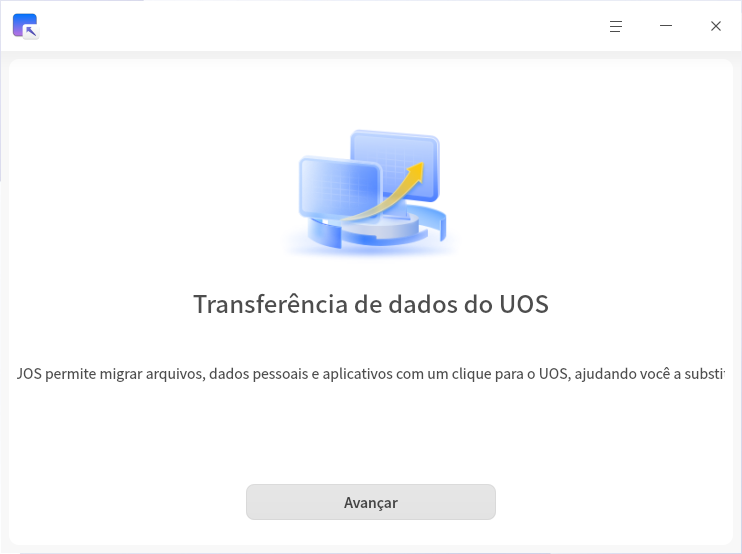
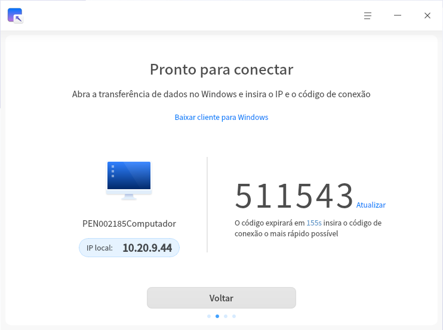
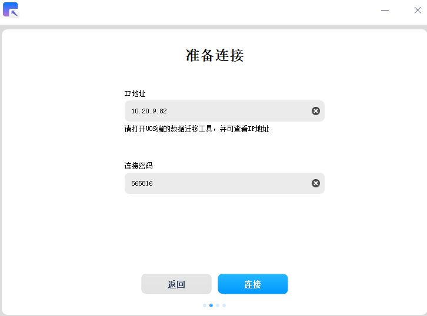
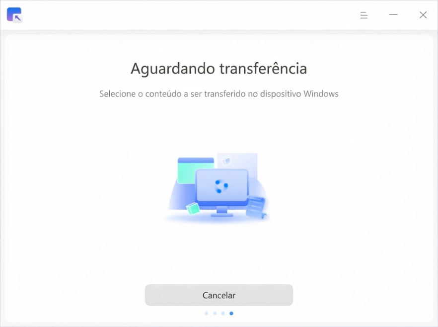
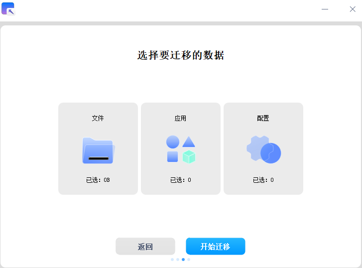
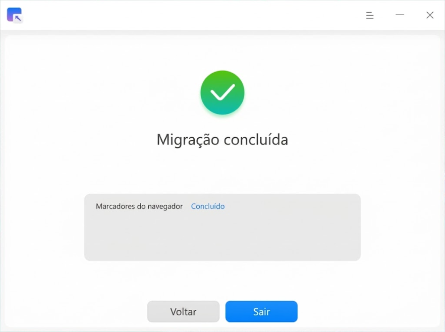

# Transferência de dados do UOS|deepin-data-transfer|

## Visão Geral

Transferência de dados do UOS é uma ferramenta de migração de dados que permite transferir, com um único clique, seus dados pessoais e dados de aplicativos do Windows para o UOS, ajudando você a realizar uma troca de sistema sem interrupções.

## Introdução ao Uso

Você pode iniciar, sair da Ferramenta de Migração UOS ou criar atalhos usando as seguintes etapas.

### Iniciar a Ferramenta de Migração UOS

1. Clique no ícone do launcher na barra de tarefas , para acessar a interface do launcher.
2. Role a roda de scroll do mouse para navegar ou use a função de busca para encontrar o ícone da Ferramenta de Migração UOS , e clique para iniciá-la.
3. Clique com o botão direito no ícone , você pode executar as seguintes operações:
   - Clicar em **Enviar para a Mesa de Trabalho**, para criar um atalho na mesa de trabalho.
   - Clicar em **Enviar para a Barra de Tarefas**, para fixar o aplicativo na barra de tarefas.
   - Clicar em **Iniciar com o Sistema**, para adicionar o aplicativo à lista de inicialização, fazendo com que ele inicie automaticamente ao ligar o computador.

## Estabelecer a Conexão

### Preparação da Conexão

Antes de iniciar a migração, certifique-se de que:

1. O remetente (Windows) e o destinatário (UOS) estejam executando a Ferramenta de Migração UOS ao mesmo tempo;
2. Os dois dispositivos estejam na mesma rede local;
3. A conexão de rede seja estável.

### Etapas da Conexão

1. Após iniciar a ferramenta de migração no lado UOS, o sistema exibirá automaticamente o endereço IP local e a senha de conexão;
2. No lado Windows, insira o endereço IP do UOS e a senha de conexão;
3. Clique no botão **Conectar** para enviar a solicitação de conexão.

>  Atenção: cada conexão suporta apenas a transferência de dados entre um par de dispositivos.

**Lado UOS:**

**Lado Windows:**

## Selecionar os Dados de Migração

Após estabelecer a conexão com sucesso:

1. O lado UOS exibirá o estado de aguardo de transferência;
2. O lado Windows exibirá a lista de dados que podem ser selecionados para migração;
3. No lado Windows, marque os tipos de dados a serem migrados, e o sistema calculará e exibirá automaticamente a quantidade de dados e o tamanho dos dados selecionados.

**Lado UOS:**

**Lado Windows:**

## Executar a Transferência de Dados

Após confirmar o escopo dos dados de migração no lado Windows, clique em **Iniciar Migração** para realizar a transferência de dados, e o progresso da transferência será exibido. O tempo de transferência depende da largura de banda e do tamanho dos arquivos a serem transferidos.

>  Se ocorrerem problemas de rede durante a transferência que causem sua interrupção, após restabelecer a conexão com sucesso, você pode clicar em **Continuar Transferência** para retomar a tarefa de transferência anterior.

## Conclusão da Migração de Dados

Após a conclusão da transferência de dados, você pode visualizar os resultados da migração no lado UOS. Os dados transferidos serão armazenados no diretório /home do seu sistema.

## Menu Principal

No menu principal, você pode alternar o tema da janela, visualizar o manual de ajuda, sair da Ferramenta de Migração UOS, entre outras opções.

### Tema

O tema da janela inclui o tema claro, o tema escuro e o tema do sistema.

1. Na interface principal da Ferramenta de Migração UOS, clique em .
2. Selecione **Tema** e escolha uma cor de tema.

### Ajuda

Visualize o manual de ajuda para conhecer e usar melhor a Ferramenta de Migração UOS.

1. Na interface principal da Ferramenta de Migração UOS, clique em .
2. Selecione **Ajuda**.
3. Visualize o manual de ajuda detalhado da Ferramenta de Migração UOS.

### Sobre

1. Na interface principal da Ferramenta de Migração UOS, clique em .
2. Selecione **Sobre**.
3. Visualize as informações de versão e a introdução de funções da Ferramenta de Migração UOS.

### Sair

1. Na interface principal da Ferramenta de Migração UOS, clique em .
2. Selecione **Sair**.
