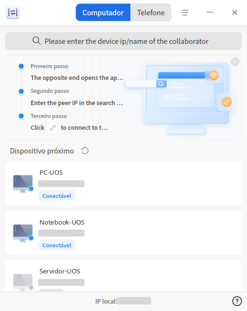
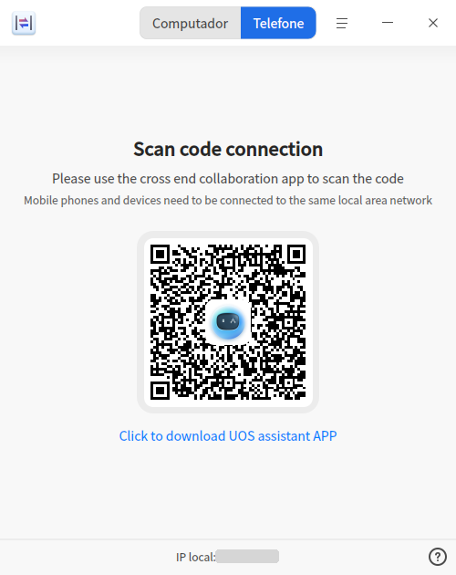

# Colaboração entre dispositivos|dde-cooperation|

## Visão geral

A Colaboração entre dispositivos é uma ferramenta de trabalho colaborativo entre vários dispositivos. Ela permite transferir arquivos e compartilhar teclado, mouse e área de transferência entre dispositivos UOS/deepin e dispositivos Windows, além de espelhar a tela de dispositivos móveis em dispositivos UOS/deepin e controlar o dispositivo móvel diretamente.

No lado UOS/deepin, o aplicativo pode ser obtido pesquisando "Colaboração entre dispositivos" na **Loja de aplicativos**. As versões para Windows e para dispositivos móveis (atualmente apenas alguns modelos Android) estão disponíveis em [https://www.chinauos.com/resource/assistant](https://www.chinauos.com/resource/assistant).

## Colaboração entre computadores

### Conectar dispositivos

**1. Selecionar o dispositivo de destino na lista de dispositivos**

Com o aplicativo "Colaboração entre dispositivos" aberto, ele procura automaticamente outros dispositivos na mesma ***sub-rede***. Os dispositivos encontrados aparecem na lista de dispositivos do aplicativo, como mostra a figura abaixo:

Localize o dispositivo de destino (identificável pelo nome do computador ou pelo IP) e clique em conectar  para concluir a conexão entre os dois dispositivos.

**2. Conectar pelo IP do dispositivo**

No campo de busca, digite o IP do dispositivo de destino e clique em conectar  para concluir a conexão entre os dois dispositivos.

### Envio de arquivos

**1. Enviar pelo botão de envio de arquivos da lista de dispositivos**

Com os dois dispositivos em estado de colaboração, clique em  na interface da lista de dispositivos, selecione os arquivos que deseja enviar na janela de seleção e clique em **OK** para iniciar o envio.

**2. Enviar pelo menu de contexto do arquivo**

Clique com o botão direito no arquivo que deseja enviar e selecione **Enviar para > Envio de arquivos**; na lista de dispositivos, escolha o dispositivo de destino e o envio é iniciado. Para enviar a um dispositivo Windows, o aplicativo Colaboração entre dispositivos precisa permanecer aberto no lado Windows.

### Compartilhamento de teclado e mouse

Quando os dispositivos A e B estão em estado de colaboração e o compartilhamento de teclado e mouse está ativado nas configurações do computador B, o mouse e o teclado do computador A controlam diretamente o computador B. Conforme o modo de disposição de telas definido nas configurações, o ponteiro do mouse pode passar de uma tela para a outra livremente.

### Compartilhamento da área de transferência

Quando os dispositivos A e B estão em estado de colaboração e a opção "Compartilhamento da área de transferência" está ativada nas configurações do dispositivo que inicia o compartilhamento, os dois computadores passam a compartilhar uma única área de transferência: o conteúdo copiado no dispositivo A pode ser colado no dispositivo B.

## Colaboração com celular

### Conectar dispositivos

Alterne a barra de navegação superior do aplicativo "Colaboração entre dispositivos" para a página "Colaboração com celular" e um QR code de conexão será exibido. Depois de instalar o "Assistente UOS" no celular, escaneie o QR code para estabelecer a conexão. A figura abaixo mostra a página de conexão em andamento.

### Espelhamento e controle

No dispositivo móvel, toque no botão "Espelhar tela", conceda a permissão de **privacidade da tela** e habilite o **serviço de acessibilidade** do Assistente UOS nas funções de acessibilidade. A tela do celular passa a ser espelhada no dispositivo UOS/deepin, e você pode tocar na tela espelhada no dispositivo UOS/deepin para operar o celular diretamente.

## Configurações da Colaboração entre dispositivos

Clique em  na barra de título e selecione **Configurações** para abrir a interface de configuração da Colaboração entre dispositivos.

1. Visível para descoberta

   Define se o dispositivo atual pode ser encontrado automaticamente por outros dispositivos na mesma sub-rede. As opções são Todos e Não permitir.

2. Apelido do dispositivo

   Facilita que outros dispositivos encontrem você por esse apelido. Por padrão, o apelido do dispositivo é o nome do computador.

3. Compartilhamento de periféricos

   Quando ativado, permite que o teclado, o mouse e o touchpad do outro dispositivo em colaboração controlem este dispositivo.

4. Direção da conexão

   Define a posição relativa das telas na disposição de telas com o dispositivo em colaboração.

5. Permitir que os seguintes usuários enviem arquivos para mim

   Define a permissão para que outros usuários na mesma rede local enviem arquivos para você. As opções são Todos, Pessoas em colaboração e Não permitir.

6. Local de salvamento dos arquivos

   Define o caminho de armazenamento dos arquivos recebidos. Por padrão, os arquivos ficam em uma pasta com o apelido do outro dispositivo, dentro do diretório de downloads do usuário atual. Você também pode escolher outro diretório como caminho de armazenamento padrão.

7. Compartilhamento da área de transferência

   Define se a área de transferência será compartilhada com o dispositivo em colaboração. O dispositivo que inicia a colaboração atua como servidor: basta que ele ative esta função para que os dois lados compartilhem a área de transferência.

## Perguntas frequentes

P: Por que não encontro meu outro dispositivo na lista de dispositivos?

R: Há algumas situações em que o dispositivo não é encontrado. Verifique uma a uma:

1. Os dois dispositivos precisam ter o aplicativo "Colaboração entre dispositivos" aberto para serem encontrados;
2. Os dispositivos não estão na mesma rede local ou estão na mesma rede local, mas em sub-redes diferentes. Nesse caso, primeiro garanta que os dois dispositivos estejam na mesma rede local e depois pesquise o IP do dispositivo de destino no campo de busca para encontrá-lo;
3. Verifique Configurações > Visível para descoberta > "Permitir todos na mesma rede local".

P: Como saber se meus dois dispositivos estão na mesma sub-rede?

R: Normalmente, basta comparar os três primeiros números do endereço IP: se forem iguais, os dispositivos estão na mesma sub-rede.

P: A transmissão de dados na Colaboração entre dispositivos e no envio de arquivos é segura?

R: Os dados são serializados com protobuf e transmitidos com criptografia SSL/TLS 1.3, o que garante a segurança dos dados durante a transmissão.

P: Por que meu celular Android não consegue estabelecer colaboração com o computador?

R: Atualmente, a colaboração entre celular e computador é compatível apenas com alguns modelos Android. Mais modelos serão adaptados nas próximas versões.

P: Depois de espelhar a tela do celular no computador, como controlar o celular pelo computador?

R: Se a tela já estiver espelhada no computador, é preciso marcar o Assistente UOS como ativado em "Serviço de acessibilidade", nas funções de acessibilidade do celular. O modo de configuração varia conforme o modelo. No Huawei nova 9 Pro (HarmonyOS 4.2.0), por exemplo, o caminho é: Configurações > Acessibilidade > Serviços instalados; localize o Assistente UOS na lista de aplicativos e ative-o.
